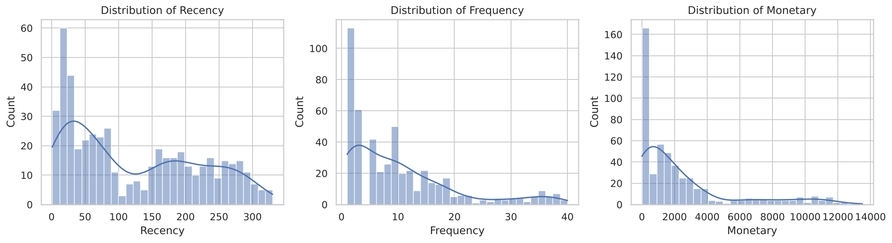
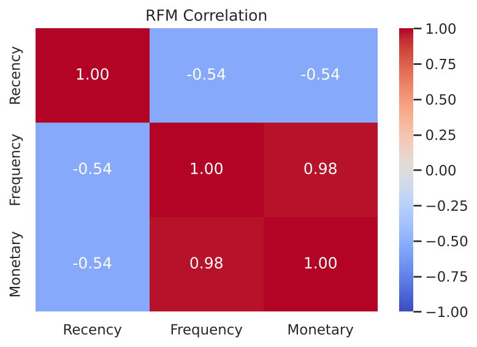
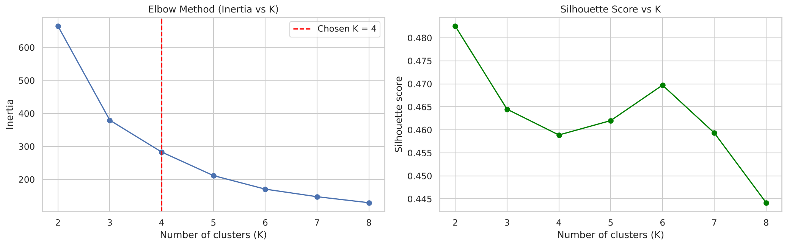
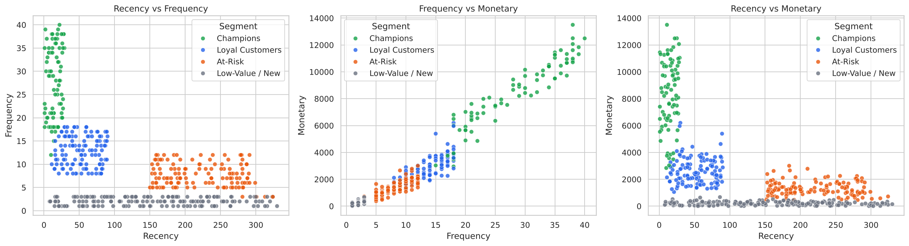
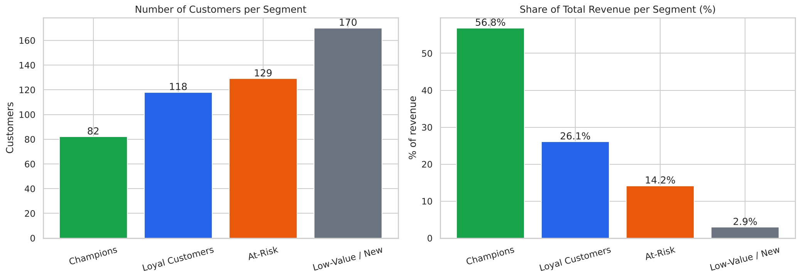

# Customer Segmentation Analysis (RFM + K-Means)

**Oasis Infobyte SIP · Data Analytics · Level 1 · Task 2**

## Objective
Segment an e-commerce company's customers into distinct groups based on purchasing behaviour, so that each group can be targeted with a suitable marketing strategy.

## Dataset
`online_retail.csv` has 37,149 transaction lines (Jan-Dec 2023) with: InvoiceNo, StockCode, Description, Quantity, InvoiceDate, UnitPrice, CustomerID, Country (same schema as the UCI *Online Retail* dataset). The file is generated by `generate_data.py`. To use the real UCI/Kaggle file, save it as `online_retail.csv` and re-run the notebook (then update the written observations).

## Method
1. Cleaning: removed duplicates, rows without CustomerID and cancelled invoices (34,612 rows, 499 customers remain)
2. Descriptive statistics: average order value, purchase frequency, customer lifetime value
3. RFM features: Recency, Frequency, Monetary
4. Log transform + `StandardScaler`
5. K-Means with the Elbow Method (plus silhouette score) -> K = 4
6. Scatter plots, cluster profiles, segment size bar chart, marketing recommendations

## Results
| Segment | Customers | Avg recency | Avg orders | Avg spend | % customers | % revenue |
|---|---|---|---|---|---|---|
| Champions | 82 | 15 days | 28.1 | 8,322 | 16% | 57% |
| Loyal Customers | 118 | 53 days | 12.8 | 2,653 | 24% | 26% |
| At-Risk | 129 | 222 days | 7.8 | 1,317 | 26% | 14% |
| Low-Value / New | 170 | 151 days | 2.0 | 207 | 34% | 3% |

**Recommended actions:** reward and retain Champions (VIP perks), grow Loyal customers with bundles and loyalty points, run win-back campaigns for At-Risk customers, and nurture Low-Value / New customers with low-cost automation.

## Visuals
| | |
|---|---|
|  |  |
|  |  |
|  | |

## How to run
```bash
pip install -r requirements.txt
jupyter notebook Customer_Segmentation.ipynb
```
The notebook also saves `rfm_customer_segments.csv` (each customer with their segment).

## Tech stack
Python, pandas, numpy, scikit-learn (KMeans, StandardScaler), matplotlib, seaborn, Jupyter Notebook
