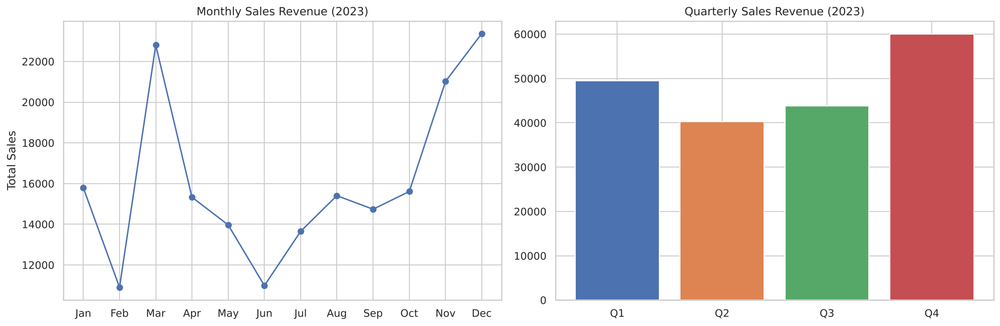
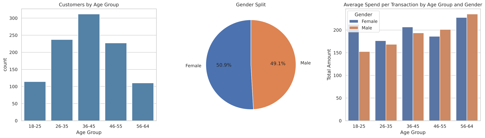
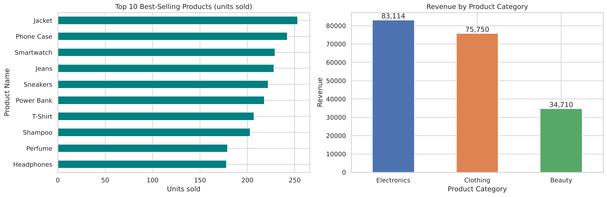
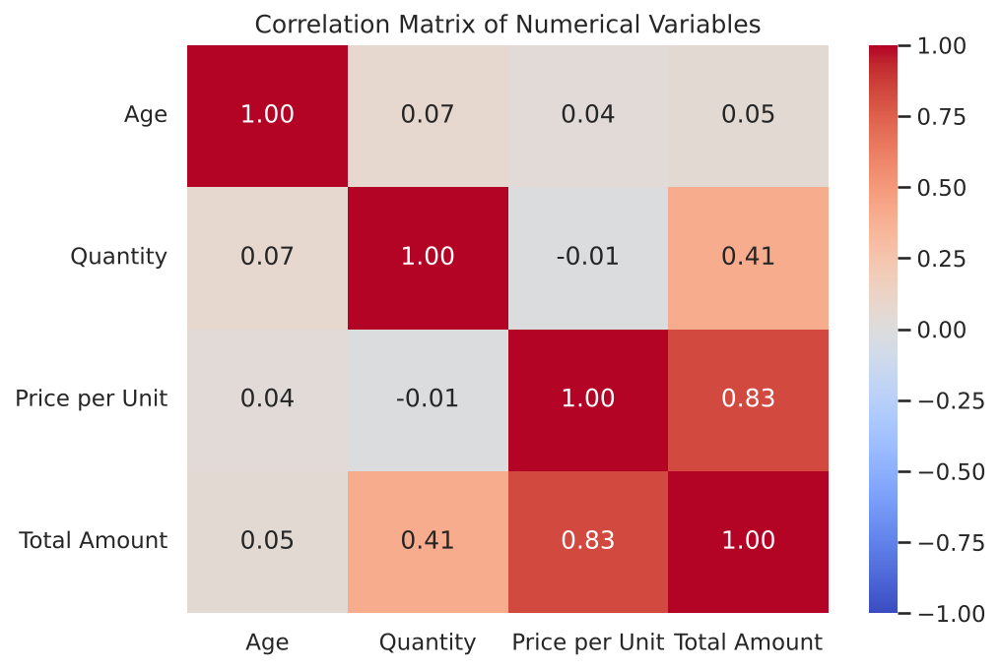
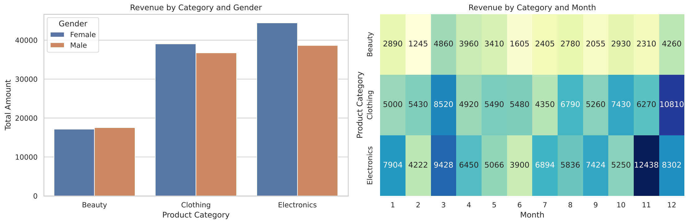

# EDA on Retail Sales Data

**Oasis Infobyte SIP · Data Analytics · Level 1 · Task 1**

## Objective
Perform an Exploratory Data Analysis (EDA) on retail sales data to uncover sales trends, customer behaviour and product performance, and turn the findings into business recommendations.

## Dataset
`retail_sales_dataset.csv` has 1,000 transactions (Jan-Dec 2023) with: Transaction ID, Date, Customer ID, Gender, Age, Product Category, Product Name, Quantity, Price per Unit, Total Amount.

The file is generated by `generate_data.py` using the same schema as the Kaggle *Retail Sales Dataset*. To use a real Kaggle dataset, replace the CSV and re-run the notebook (column names may need small adjustments).

## What the notebook covers
- Data inspection: shape, dtypes, null and duplicate checks
- Descriptive statistics: mean, median, mode, standard deviation
- Time series: monthly and quarterly sales trends
- Customer demographics: age groups and gender
- Product analysis: top 10 products, revenue by category
- Correlation heatmap
- Extra insight: category x gender and category x month heatmap
- Markdown observations after every chart, and a conclusion with 4 recommendations

## Key findings
- Sales peak in Q4 (Nov-Dec, ~31% of annual revenue); February and June are weakest.
- Electronics (43%) and Clothing (39%) drive most revenue; Smartwatches are the top revenue product.
- The 36-45 age group is the largest; 56-64 customers have the highest average basket.
- Spend is driven by price and quantity, not by age.

## Visuals
| | |
|---|---|
|  |  |
|  |  |
|  | |

## How to run
```bash
pip install -r requirements.txt
jupyter notebook EDA_Retail_Sales.ipynb
```

## Tech stack
Python, pandas, numpy, matplotlib, seaborn, Jupyter Notebook
