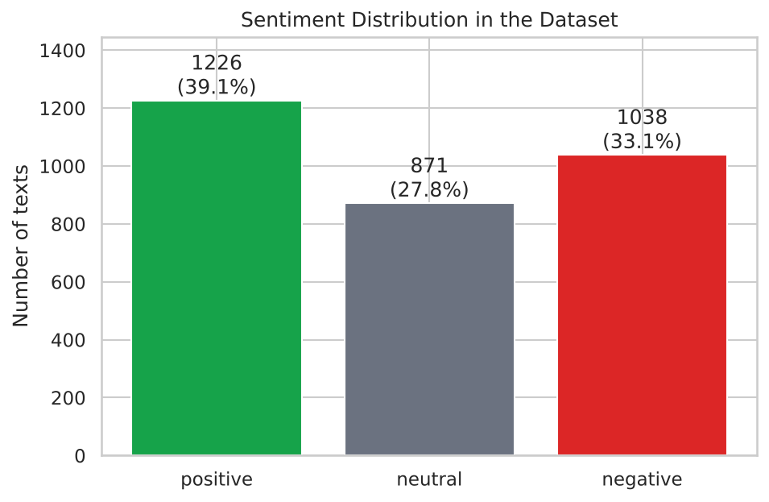
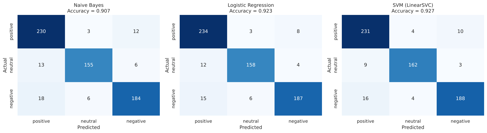
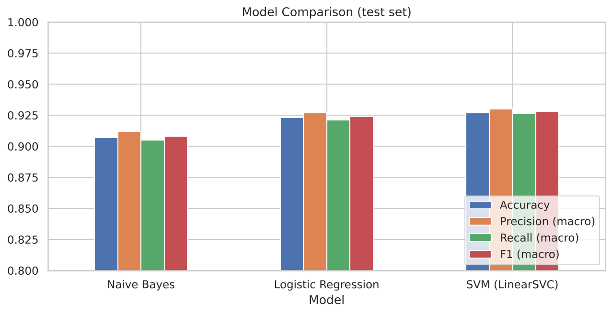
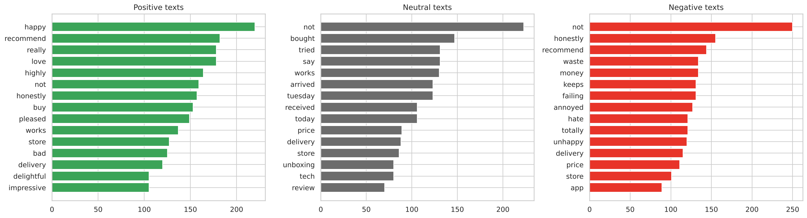

# Sentiment Analysis: Positive, Neutral or Negative

**Oasis Infobyte SIP · Data Analytics · Level 1 · Task 4**

## Objective
Build machine learning models that classify the sentiment of text (positive, neutral, negative) and draw insights about customer opinion.

## Dataset
`sentiment_reviews.csv` has 3,135 short product reviews / tweets with a sentiment label (id, text, sentiment): positive 39.1%, negative 33.1%, neutral 27.8%. It is generated by `generate_data.py` (informal text with mentions, URLs, hashtags, negation, mixed opinions and a few mislabelled rows). To use a real dataset (Kaggle *Twitter Sentiment Analysis*, *Amazon Product Reviews*, *IMDB*), save it as `sentiment_reviews.csv` with columns `text` and `sentiment` and re-run.

## Method
1. Class distribution check and bar chart
2. Preprocessing: lowercase, remove URLs/mentions/punctuation, tokenise, remove stopwords (NLTK; negations like "not" are kept on purpose), optional stemming
3. Stratified 80/20 train/test split
4. TF-IDF features (unigrams + bigrams), fitted on training data only
5. Three classifiers: Multinomial Naive Bayes, Logistic Regression, Linear SVM
6. Evaluation: accuracy, precision, recall, F1, confusion matrix
7. WordClouds / top words per sentiment
8. Error analysis with 5 misclassified examples

## Results
| Model | Accuracy | Macro F1 |
|---|---|---|
| Naive Bayes | 0.907 | 0.908 |
| Logistic Regression | 0.923 | 0.924 |
| **Linear SVM** | **0.927** | **0.928** |

**Best model:** Linear SVM. **Main weakness:** negation and mixed opinions ("great, but..."): 61% of errors contain not/but/never/no versus 26% of all test texts. **Real-world use:** flag negative customer messages for support, track opinion over time after a product launch, and find which topics drive complaints. **Limitation:** results come from a synthetic dataset and are probably more optimistic than on real social-media text.

## Visuals
| | |
|---|---|
|  |  |
|  |  |

The last image shows the top words per sentiment (drawn as WordClouds when the `wordcloud` package is installed, otherwise as bar charts).

## How to run
```bash
pip install -r requirements.txt
jupyter notebook Sentiment_Analysis.ipynb
```

## Tech stack
Python, pandas, numpy, scikit-learn (TF-IDF, Naive Bayes, Logistic Regression, LinearSVC), NLTK, WordCloud, matplotlib, seaborn, Jupyter Notebook
