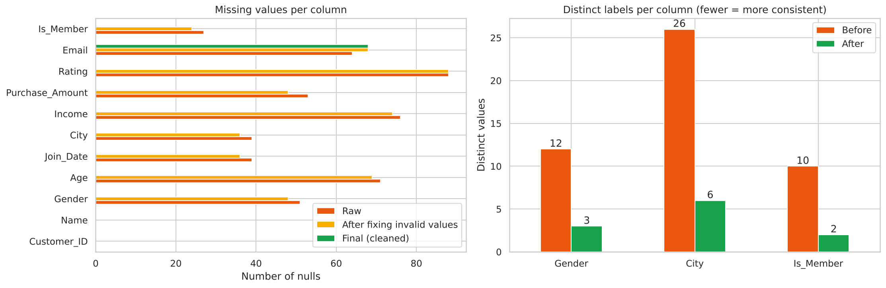
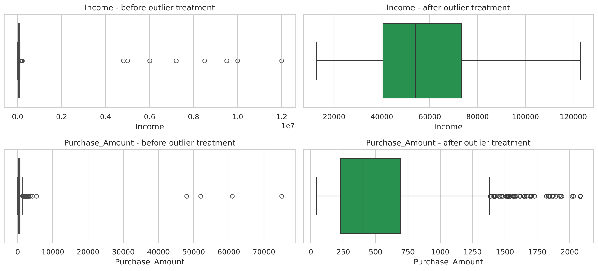

# Data Cleaning: From Messy Data to Analysis-Ready

**Oasis Infobyte SIP · Data Analytics · Level 1 · Task 3**

## Objective
Take a deliberately messy dataset and systematically turn it into a clean, analysis-ready dataset, documenting every decision.

## Dataset
`messy_customer_data.csv` has 1,300 rows and 11 columns (Customer_ID, Name, Gender, Age, Join_Date, City, Income, Purchase_Amount, Rating, Email, Is_Member). It is generated by `generate_data.py` with every common problem injected: missing values, exact and hidden duplicates, inconsistent labels and formats, wrong data types, invalid values and outliers. To use a real Kaggle messy dataset, replace the CSV and adapt the column names.

## Cleaning steps (all in the notebook)
1. Data quality report (nulls, duplicates, dtypes, value ranges, label inconsistencies)
2. Standardisation: text case, Gender/City/Is_Member labels, numbers stored as text, mixed date formats
3. Duplicate removal (after standardisation, which revealed 40 hidden duplicates)
4. Invalid values (impossible ages, negative incomes, ratings outside 1-5, bad emails) converted to missing
5. Outliers: IQR (Income, Purchase_Amount) and Z-score (Age), with a documented decision per column
6. Missing data: median for numeric columns, mode for City/Is_Member, "Unknown" for Gender, row deletion for Join_Date, Email left missing
7. Data type correction
8. Before vs after summary table
9. Cleaned data saved to `cleaned_customer_data.csv`

## Before vs after
| Metric | Before | After |
|---|---|---|
| Row count | 1,300 | 1,164 |
| Total null cells | 508 | 68 (Email, left on purpose) |
| Columns containing nulls | 9 | 1 |
| Exact duplicate rows | 60 | 0 |
| Duplicate Customer_IDs | 100 | 0 |
| Invalid values | 22 | 0 |
| Columns with correct dtype | 4 of 11 | 11 of 11 |

## Visuals
| | |
|---|---|
|  |  |

## How to run
```bash
pip install -r requirements.txt
jupyter notebook Data_Cleaning.ipynb
```

## Tech stack
Python, pandas, numpy, matplotlib, seaborn, Jupyter Notebook
