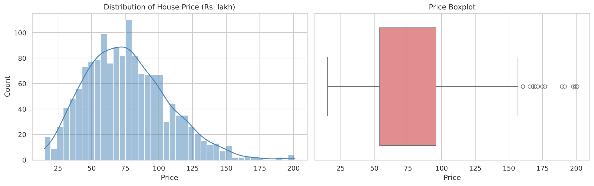
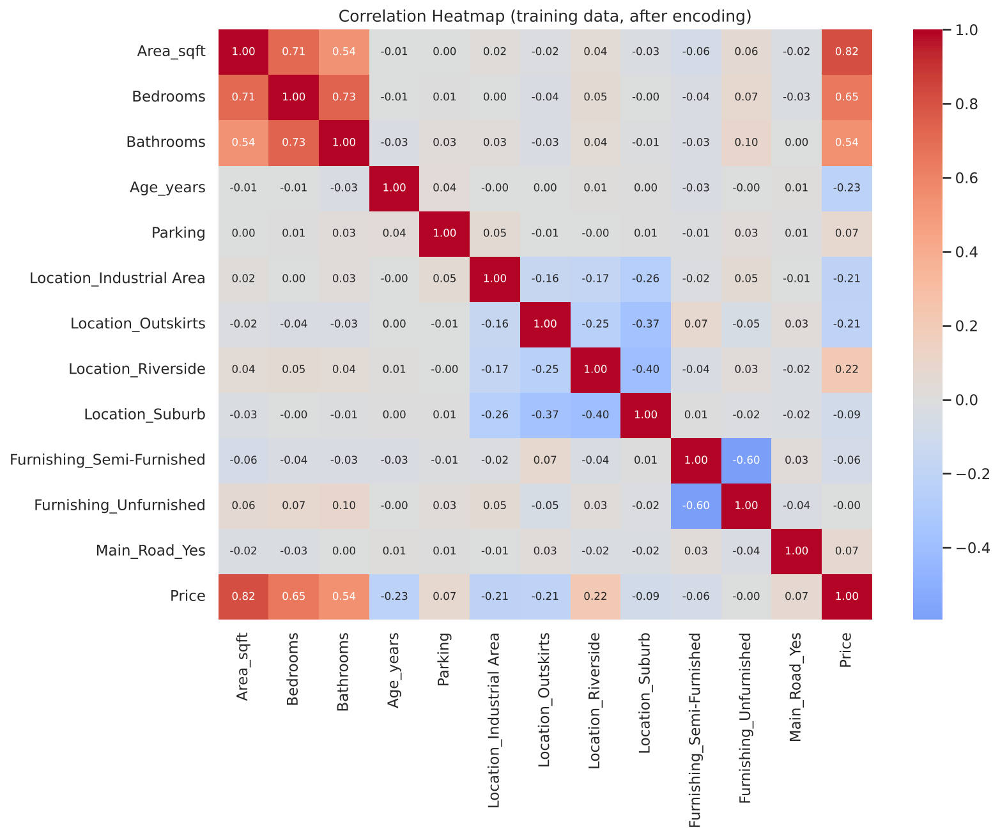
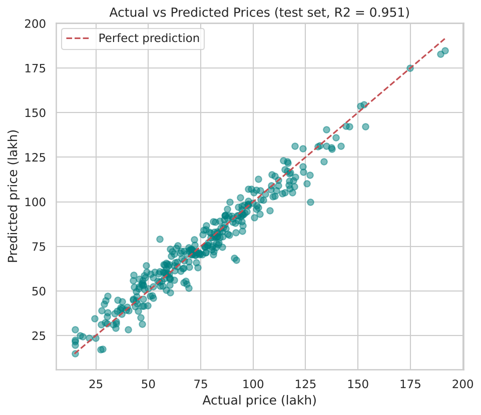
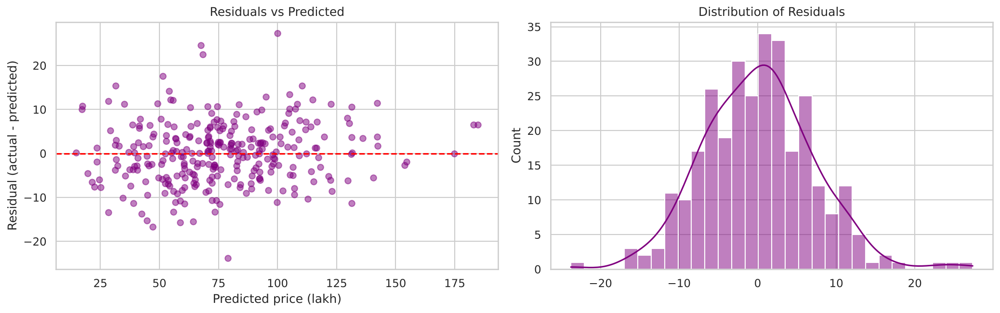
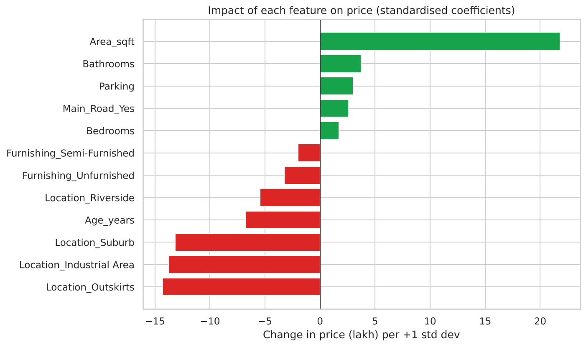

# Predicting House Prices with Linear Regression

**Oasis Infobyte SIP · Data Analytics · Level 2 · Task 1**

## Objective
Build and evaluate a linear regression model that predicts house prices from features such as area, location, number of rooms and age, from data cleaning through to model interpretation.

## Dataset
`house_prices.csv` has 1,500 houses with 8 features (Area_sqft, Bedrooms, Bathrooms, Age_years, Parking, Location, Furnishing, Main_Road) and the target `Price` (Rs. lakh). It is generated by `generate_data.py` and includes missing values. To use a real dataset (Kaggle *House Prices: Advanced Regression Techniques* or *Housing Prices*), save it as `house_prices.csv` with a numeric `Price` column and adapt the feature lists in the notebook.

## Method
1. EDA: nulls, descriptive statistics, price distribution
2. Feature selection discussion (all 8 features kept, with multicollinearity noted)
3. Missing values (median / mode) and One-Hot Encoding, with the train/test split done first to avoid data leakage
4. Correlation heatmap
5. Train/test split (80/20) and `LinearRegression`
6. Evaluation: MSE, RMSE, MAE, R2 plus 5-fold cross-validation
7. Actual vs predicted scatter plot and residual plots
8. Coefficient analysis (raw and standardised)
9. Bonus: Ridge and Lasso comparison

## Results
| Metric | Train | Test |
|---|---|---|
| MSE | 55.4 | 49.3 |
| RMSE (lakh) | 7.4 | 7.0 |
| R2 | 0.941 | 0.951 |

- The model explains about 95% of price variation; a typical error is about 7 lakh (9% of the average price). 5-fold cross-validated R2 is about 0.94, so there is no overfitting.
- **Most important features:** Area (+0.044 lakh per sqft), then Location (compared with City Center, Industrial Area is 45 lakh cheaper and Outskirts 37 lakh cheaper), then Age (-0.53 lakh per year). Bathrooms (+4.6), main road (+5.2) and parking (+3.2) add smaller premiums.
- Residuals are random and centred around zero.
- Ridge (R2 0.949) and Lasso (R2 0.950) do not improve on plain Linear Regression (R2 0.951).
- **Limitation:** the data is synthetic with mostly linear relationships, so real data would give a lower R2.

## Visuals
| | |
|---|---|
|  |  |
|  |  |
|  | |

## How to run
```bash
pip install -r requirements.txt
jupyter notebook House_Price_Prediction.ipynb
```

## Tech stack
Python, pandas, numpy, scikit-learn (LinearRegression, Ridge, Lasso, ColumnTransformer), matplotlib, seaborn, Jupyter Notebook
