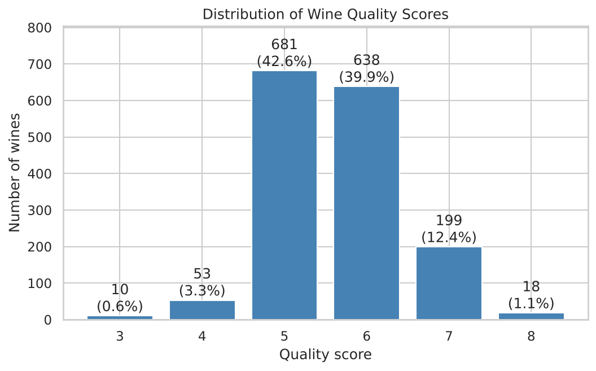
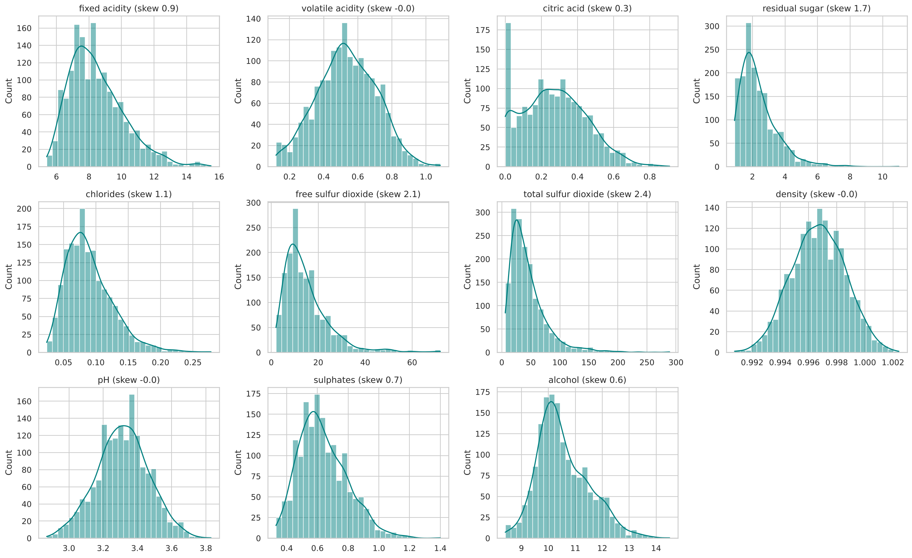
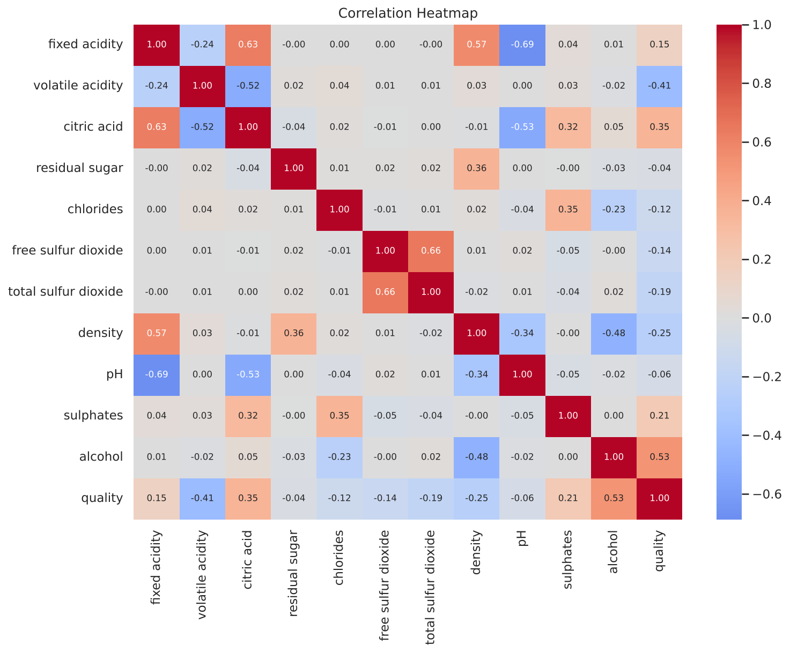
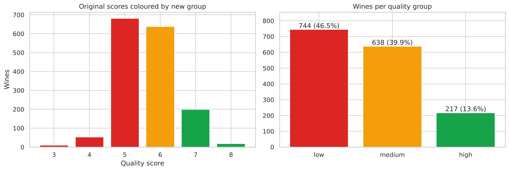
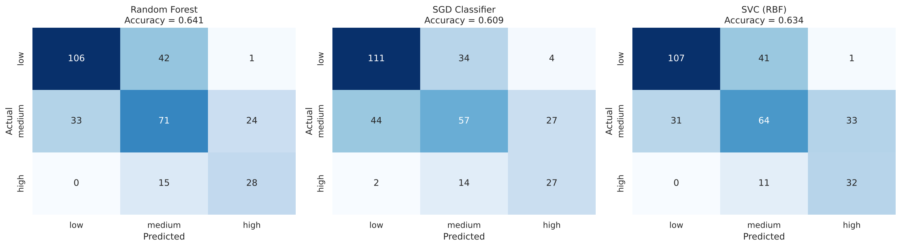
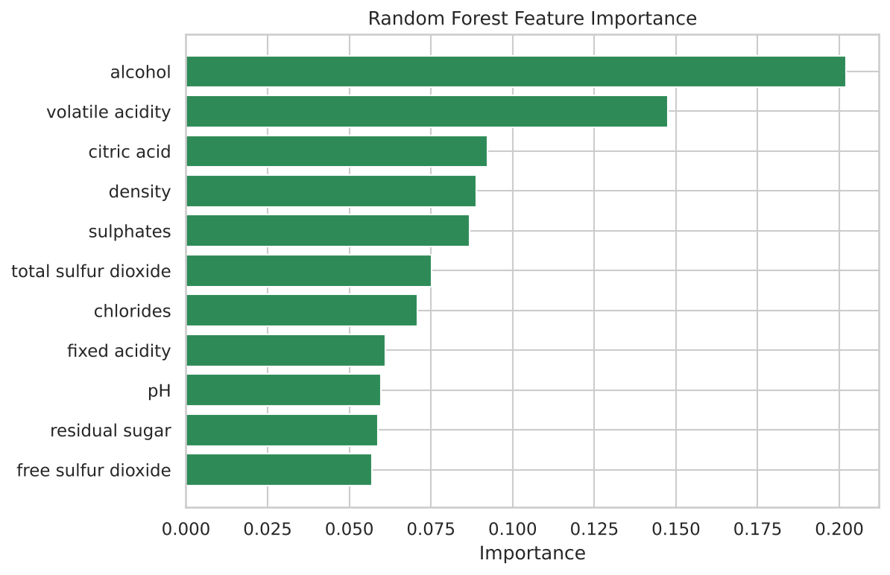
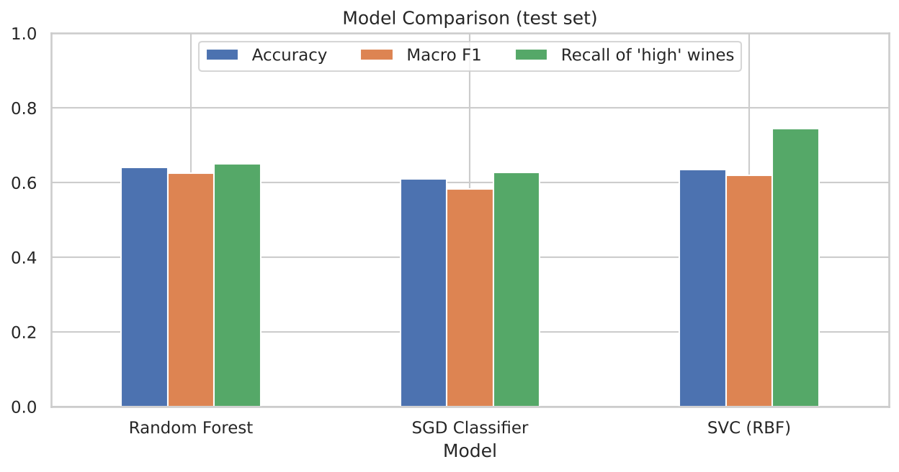

# Wine Quality Prediction: Random Forest vs SGD vs SVC

**Oasis Infobyte SIP · Data Analytics · Level 2 · Task 2**

## Objective
Train and compare multiple classification models to predict wine quality from physicochemical properties, handling the strong class imbalance in the quality scores.

## Dataset
`winequality.csv` has 1,599 red wines with 11 chemical features and a `quality` score (3-8). It is generated by `generate_data.py` and mimics the UCI / Kaggle *Wine Quality* (red) dataset (same columns, ranges, correlations and imbalanced score distribution). To use the real data, download `winequality-red.csv` from UCI (archive.ics.uci.edu/dataset/186/wine+quality) or Kaggle, save it as `winequality.csv` and re-run (the `;` separator is detected automatically).

## Method
1. Inspection and class distribution of quality scores (largest class is about 68 times the smallest)
2. EDA: distribution plots of all features, correlation heatmap
3. Class imbalance discussion and remedies
4. Feature engineering: quality binned into 3 groups (low 3-5, medium 6, high 7-8), justified with an experiment (6 classes: macro F1 0.27; 3 groups: macro F1 0.63)
5. Stratified 80/20 train/test split
6. Models: Random Forest, SGD Classifier and SVC (RBF), all with balanced class weights; SGD and SVC use StandardScaler
7. Evaluation: accuracy, classification report, confusion matrix, 5-fold cross-validation
8. Random Forest feature importance and model comparison table

## Results
| Model | Accuracy | Macro F1 | Recall of 'high' wines | 5-fold CV Macro F1 |
|---|---|---|---|---|
| **Random Forest** | **0.641** | **0.625** | 0.651 | **0.617** |
| SVC (RBF) | 0.634 | 0.619 | 0.744 | 0.609 |
| SGD Classifier | 0.609 | 0.583 | 0.628 | 0.582 |

- **Recommended for deployment: Random Forest** (best overall, no scaling needed, gives feature importance). SVC is a good alternative if catching premium wines matters most.
- **Most important features:** alcohol, then volatile acidity; citric acid, density and sulphates follow.
- The models rarely confuse low and high wines; most errors are between neighbouring groups, and "medium" is the hardest group.
- **Limitation:** the data is synthetic, built to mimic the real dataset, so results on the real file will differ somewhat.

## Visuals
| | |
|---|---|
|  |  |
|  |  |
|  |  |
|  | |

## How to run
```bash
pip install -r requirements.txt
jupyter notebook Wine_Quality_Prediction.ipynb
```

## Tech stack
Python, pandas, numpy, scikit-learn (RandomForestClassifier, SGDClassifier, SVC), matplotlib, seaborn, Jupyter Notebook
